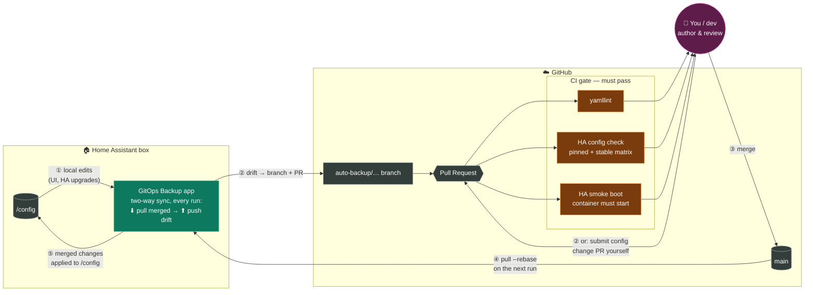

# HA GitOps — Home Assistant App

**PR-gated GitHub backup for your Home Assistant config.** Nothing force-pushes,
every change is a reviewable pull request, and CI validates your config against
pinned Home Assistant versions *before* it can merge.

[](https://my.home-assistant.io/redirect/supervisor_add_addon_repository/?repository_url=https%3A%2F%2Fgithub.com%2Fmmornati%2Fha-gitops)

[](https://github.com/askb/ha-gitops/releases/latest)
[](https://github.com/askb/ha-gitops/releases)
[](LICENSE)

## Why another config-backup app?

Most config-sync tools upload your files straight onto a branch — some even
force-push. That gives you a *copy*, not *control*. This app treats your
config like production infrastructure:

| | Direct-push sync tools | GitOps Config Backup |
|---|---|---|
| Changes land on main | Immediately, sometimes force-pushed | **Never** — every drift becomes a PR |
| Review before accept | No | **Yes** — diff, comment, merge (or close) |
| CI validation | No | **Yes** — HA version-matrix check **+ smoke boot** (config must actually start) gate the merge |
| Bidirectional | Usually one-way upload | **Yes** — merged PRs flow back on the next run |
| Secrets safety | gitignore defaults | gitignore defaults **+ CI runs with stub secrets only** |

## How it works



**The loop, numbered:** ① you edit via the HA UI (or an upgrade changes files) →
② the app turns that drift into a PR — or you open a config PR yourself →
③ CI gates it, you merge → ④ the app's next run pulls merged `main` →
⑤ and applies it to `/config`. Both directions go through the same run:
it **pulls first, then pushes drift**, so box and repo converge on `main`.

1. **Daily (configurable) run** on your Home Assistant box:
   stash local drift → `pull --rebase` from `origin/main` (picks up PRs you
   merged) → re-apply → if the live config changed, commit to a dated
   `auto-backup/…` branch and **open a PR** via the GitHub API.
2. **CI on the PR** (template workflows included): yamllint + full
   `frenck/action-home-assistant` validation against a pinned HA version (with
   a `stable` early-warning leg) **+ a smoke boot** — the pinned HA Core
   container starts with your config and must answer HTTP with no
   `Invalid config` — upgrade breakage surfaces in CI, not on your Pi.
3. **You merge** (from your phone, if you like). The next app run rebases the
   merged state back onto the box.

## Install

1. Add this repository to your App store (badge above), install
   **GitOps Config Backup**.
2. Create a GitHub repo (private recommended) and a fine-grained PAT with
   *Contents: read/write* and *Pull requests: read/write* on it.
3. Configure the app:

```yaml
github_repo: you/your-ha-config
github_token: github_pat_…
base_branch: main
branch_prefix: auto-backup
interval_hours: 24
run_at_start: false
dry_run: true        # start with a dry run, check the log, then set false
signoff: true
```

4. Copy `template/workflows/validate-ha-config.yaml` into
   `.github/workflows/` of your config repo, and add a stub line for every
   `!secret` key you use (CI never sees real secrets).
5. (Recommended) Protect `main` in the repo settings: require the
   *HA Config Validation* check.

First run bootstraps the git repo in `/config` (seeding a Home Assistant
`.gitignore` covering `secrets.yaml`, `.storage/`, databases, logs) and pushes
the initial import; every run after that only ever opens PRs.

## Real time and control (0.4.0)

- **Merged PRs go live in seconds**: a signed GitHub webhook, or a 60 s
  `git ls-remote` poll that does not use the REST API quota.
- **Local edits become a PR in minutes**: a file watcher with a debounce
  adds them to **one rolling PR** instead of a new PR per run.
- **Safe apply**: HA config check first, then only the reloads the changed
  files need; restarts are notified, not forced (unless you opt in).
- **Control from HA**: an MQTT device with status sensors, Sync / Back up
  buttons and Pause / Auto-apply switches; `hassio.addon_stdin` commands;
  `ha_gitops_*` events for automations.
- **GitOps panel** in the sidebar: status, open PR and checks, pending diff,
  history with one-click revert PRs, and the log.

See the app's **Documentation** tab for setup and every option.

## Security notes

- The token lives in the app options, never in git, and never in
  `/config/.git/config` (git reads it through an askpass helper).
- The webhook only acts on deliveries signed with your `webhook_secret`; the
  panel is reachable only through HA ingress.
- The seeded `.gitignore` excludes `secrets.yaml`, `.storage/`, `.cloud/`,
  databases, logs, and the app's own status/log files (committing status
  files creates a PR-per-day feedback loop — learned the hard way).
- CI validates with **stub** secrets; your real `secrets.yaml` never leaves the box.
- Nothing in this app ever force-pushes or writes to your base branch after
  the initial bootstrap import. Reverts are PRs too.
- **This is change tracking, not disaster recovery** — pair it with HA's
  native encrypted backups + the Google Drive Backup app for full system
  state (`secrets.yaml`, `.storage/`, databases, apps). See the app
  DOCS for the full "what is backed up where" table and where secrets belong.

## License

Apache-2.0
